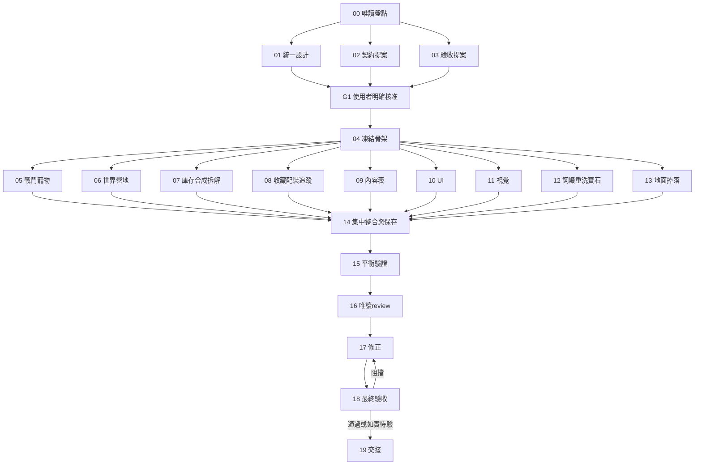

> 可攜交接更新：04_READY_FOR_RE_REVIEW；契約 BASE_CONTRACT_V1.1。以下111項屬首次交付歷史；本次修復結果見 [04交接](../04-contracts.md)。05–19未啟動。

# Evernight-Packbound 整合正式版 Roadmap

## 最新授權與停點：G1_APPROVED／04_READY_FOR_REVIEW

2026-10-08：使用者核准其餘01–03並同意只做04、完成停下。04已交付BASE_CONTRACT_V1（工作樹＋SHA清單，沒有commit）。基線仍為1e2ac7e891835e85f9f31b02a1166cd99f9cbb52；111項測試、type/build、瀏覽器回歸通過。詳見[04交接](<../04-contracts.md>)。

B獲准作首輪實測候選，15/10/5弱連擊候選保留；prepared早期55/中後50裝位與20寵位、95%聯合容量目標纳入驗收；不採撤回的減供81%表，不宣稱平衡已驗收。只完成契約骨架與舊檔保護，05–19未啟動；不能因G1核准自行派後續任務、commit、merge、push或部署。

下列原規劃記錄的G1_PENDING／只准文件／04未開始由本節覆蓋；工程依04接口及完整工作樹，不能只checkout舊base。葉白名單及DAG保留，BASE_UPGRADE仍只來源。

## 核准前規劃記錄

整合包 v2 修訂 r2｜G1-feedback-02｜2026-10-08｜integrated-v2-r2｜G1_PENDING｜20個工作任務＋1個核准gate。

**使用者已確認先前改版提示詞還沒交給Codex，現在要整合成一包。因此本包直接從目前未改版專案起步，取代先前「正式版＋外部P0前置」的包。只需要派這一包，不必先做另一輪改版。**

目前授權是製作規劃包；遊戲碼要等00–03交出統一設計並獲G1明確核准後才開始。未授權不merge、push或部署。

## 0. 本輪狀態與唯一文件位置

最新需求是2026-10-08對話（裝備倉庫60已確認、掉率未批准、依不同進度成熟刷關平衡）；其餘沿用 [2026-10-06修正指令](<sources/Evernight-Packbound_正式版規劃修正指令.md>)。使用者已接受Task 00對話回報，並授權修正01–03與路線圖／工單；尚未核准G1，不啟動04。再次唯讀核實本機 `main / 1e2ac7e891835e85f9f31b02a1166cd99f9cbb52`，開始時僅前輪8份規劃未提交，AGENTS.md空白；玩家存檔未操作。

| 文件 | 唯一用途／位置 |
|---|---|
| 本包 ROADMAP、TASK_INDEX、DISPATCH、tasks/ | 正式版派工、依賴、owner与白名單，留在原解壓目錄 |
| 專案 `docs/release/01-*.md、02-*.md、03-*.md` | 同版待核准設計／契約／驗收；不複製到本包成第二份 |
| 專案 [requirements-r2.md](<../requirements-r2.md>) | 最新確認／保留／r1失效／待決／工單影響與驗證狀態 |
| 專案根 ROADMAP.md | 原型歷史與本輪規劃入口；下面已完成核取不代表正式版完成 |
| 00回報 | 使用者已接受的對話內容，沒有另外存在的00-audit.md；不能假稱已讀不存在的檔 |
| reference/BASE_UPGRADE.md | 原需求來源附錄，已標失效項，不另執行前置包 |

`integrated-v2-r1` 全部未被核准；本輪統一以 `integrated-v2-r2` 提案互核。名稱與各表尚待使用者確認，不能用工程方便補決策。來源優先：最新使用者指令／既有確認規則 → 同版01–03待核准提案 → 本包派工安排；歷史記錄只供追溯。

### G1-feedback-02：60件已確認、首輪平衡候選仍待批

裝備倉庫60件已確認，已裝備不占倉庫；寵物容量仍30候選、背包最多48格分開。保留連擊弱直傷、以觸發為主及15/10/5首輪候選、全部逐擊規則／上限。整理後成熟重刷已通關至少約15分鐘免容量操作的目標不變。

全部掉率未核准，feedback01的30件低供給主案與60件減少約81%替代表不再作推薦。首輪推薦B與S/C比較唯一數表在專案01 T04/T10、03：按初／中／後具體成熟配裝與action紙算列收穫、合成材料等待、首容量期望及尾險；中期滿武器孔25秒、後期滿6武器孔27.5秒、空孔30.5秒對照與25秒快側風險分列，所有深關21秒只作極端壓測。prepared推薦早期5/60（55空）、中後與返刷10/60（50空），另驗15/60（45空）；寵物10/30含active、20空，18寶石堆各100且無玩法cap。這些起點不是遊戲開打門檻。

95%聯合不中斷率仍待核准，B的25秒快側未達此提案門檻，不能把主profile的紙算合格當引擎／真人通過；C提供較穩容量但較慢素材的取捨。不恢復auto合成、不新增auto丟棄／拆解、不拖慢戰鬥。只同步受影響規格與驗收，owner／DAG及其它已對齊內容保留，G1_PENDING且04–19未啟動。

## 1. 正式版目標與範圍

供自己與家人長期玩。以能主動研究配裝、刷關半小時以上為優先，同時支援低操作量的前景掛機；可以多農一些裝備與寵物再挑戰頭目，不追求急著通關。沒有離線收益。

正式版以「區域分支＋區內逐關深化＋自由流派＋長期收藏與配裝」延伸目前改版。區域提供不同用途的專屬裝備；同品質橫向取捨，區域內更深才增加高品質機會。不是後面區域所有東西都更強。

### 使用者已確認

- 至少7區、每區至少10關、每關至少10波；多怪波最多同時5敵，不是每波固定5隻。初始區之後分支，區內逐關，每關最後一波頭目且重打仍有。
- 核心是刷裝、手動合成、寵物成長；可在穩定關卡農好再挑戰。裝備／區域／寶石／寵物共同形成流派，單件不能包辦完整流派；同品質跨區橫向取捨，舊區深處增加高品質機會。
- 自動回合，保留快速連擊、範圍、吸血、持續回復及毒或燃燒、蓄力、上限過療盾、擊殺連鎖、寵物合作等方向。詞條是隨機基本數值；取消攻速，改真連擊次數，寶石可提供機制互動。
- 戰鬥同屏完整已裝備背包；整理上背包下60件倉庫，詳情獨立，背包最多48格。拖放、旋轉、自然輪廓、位置攻序及倉庫穩定排序保留。粗線卡通／森林金葉／A2圓體。
- 重打開關持久保存；整理、手動、容量不足、營地、背景、載入只停執行不清設定。開啟／讀檔先暫停營地，明確繼續才恢復；不自動推關／選分支，不跳過死亡與必要結算選擇。
- 地物先落地、靠近或點擊撿取，同一所有權與一次性交易；未撿保留，放不下暫停。首次狼依00核實全存檔一次，不能每次重打發狼。
- 手動同種同品質一次確認，90/80/70/60/50%，失敗只耗材料、無保底。移除全部裝備／寵物自動合成。保留主體詞條／石，材料石免費退回、不能容納整筆拒絕；寵物既有高XP及出戰限制不變。
- 詞條掉落時隨機、材料重洗整組直接覆蓋；寶石取得等級固定，可免費拆換／重鑲，同種同級堆疊，獨立收納，不升級不合成。早期就能組簡單搭配。
- 單件手動拆解一次確認；已裝備先卸下，鎖定不可當材料／丟棄／拆解但可當升級主體，退石原子。追蹤含裝備／寶石來源、持有量及缺料，不自動開打。
- 收藏永久保留曾取得內容，獎勵以外觀為主；不能擅改成已確認「只能外觀」，也不暗加能力。配裝引用持有ID、缺件明示。營地留商店擴充空間，本版不做交易。
- 保留資料與備份／遷移／失敗恢復；無離線收益、職業、技能樹、鄰接、每日壓力或課金。主動≥半小時与低操作前景情境分開驗證。

### 本輪仍需提案並核准

區域名稱／主題／解鎖／逐關數值與完整編成、裝備特色與分工、連擊計數／每擊傷害／暴擊／吸血／附效／cap、詞條數量／池／範圍／權重／成本、早期孔／寶石種類／等級／來源／收納、挑戰及收藏獎勵、配裝槽數／套用策略、地物跨新關／死亡／營地處理、存檔契約及驗收門檻。批次拆解未核准。01須提出推薦、替代與影響，不把整份設計變問卷。

r1的3區9關8波／最多3敵、白0詞條／紫才有孔／4寶石／999堆疊、戰鬥只縮圖、pause清重打開關、先全收並額外留一格等已失效，不能轉成fixture或工程硬限制。r2若仍推薦某個相同數字，也必須重新說明理由並等G1。

## 2. 從現有專案直接開始

公開對照：[Evernight-Packbound](https://github.com/Jack060719/Evernight-Packbound)，commit `1e2ac7e891835e85f9f31b02a1166cd99f9cbb52`。TypeScript／Vite／Phaser，3層×5波、約8種裝備、2隻寵物。59條是歷史測試報告，不是本輪已執行結果，也不是未來必須固定數量。

公開基線已有多敵波、整理／容量暫停與不補算離線進度。尚無完整營地、地上掉落、詞綴、寶石、鎖定、拆解、收藏、配裝或寵物里程碑；自動合成與約65%統一掉落仍在，僅第3層第5波有頭目，存檔僅有v1→v2遷移。pending overflow不是地面掉落、回營地按鈕文字不代表系統完成。

00已接受；後續換基線仍先唯讀看本機branch／commit／git status／AGENTS.md。使用者尚未把原提示詞交出去，不等於可以忽略其他本機改動。無存取就列未知並請提供必要狀態，不能假裝查過。

附錄 `reference/BASE_UPGRADE.md` 保留原改版需求作核對，**是來源附錄，不是另一份要先執行的任務**。其所有適用需求已分配到本包實作；其中「暫留3×5、每層未必有頭目、不能自動重打」被本包正式版決定取代：區域分支、更多關波、每關末波頭目、可選同關自動循環。其小規模與單純數值寶石示例亦由最新修正取代；其他已確認規則延續，舊示例不是核准值。

## 3. 基礎改版不再是缺席的前置：完整落到工單

| 需求 | 實作owner | 整合與驗收 |
|---|---|---|
| 營地、啟動／讀檔暫停、繼續、新旅程、凍結戰鬥、生命與回合、背景不偷跑、區域／關卡／結算／重打 | 06 world/stage-flow/camp；05戰鬥時間與生命 | 14接main/save；18驗收 |
| 唯一ID地上掉落、靠近／點擊同交易撿取、實際待領容量不足保留暫停、跨死亡／切關／刷新安全 | 13 ground-loot/pickup/lifecycle；07庫存port | 14唯一sampler／receipt／保存；11動效 |
| 降低並分化掉落、區內品質提升、首狼保證、區域專屬池 | 09純資料；13消費注入sampler | 14唯一reward-resolution；15分布與產量 |
| 戰鬥同屏完整背包；整理上背包下倉庫60件／48格、拖放旋轉、獨立詳情、排序不改攻序、鎖定 | 07庫存／placement／排序命令，10UI | 14掛載；18手機 |
| 移除全部自動裝備／寵物合成，包括舊旗標與隱藏邏輯 | 07新流程；10刪選項；14刪舊引擎路徑／舊旗標失效 | 14舊存檔／舊命令回歸 |
| 手動同種同質、單次確認、90/80/70/60/50%、失敗只消耗材料、主詞綴寶石保留、材料寶石退回、寵物高經驗／出戰限制 | 07 synthesis；12寶石／升品質port；05里程碑重算 | 14同一交易提交 |
| 品質／格數／件數收益與合成風險、長期刷寶 | 01表格→09資料→15實測；10預覽 | 16review／18驗收 |
| 數值詞條（真連擊／暴擊／吸血等，無攻速）、掉落生成與整組重洗直接覆蓋 | 12 affixes/reroll | 14扣款／結果／RNG／版本一起保存 |
| 機制寶石、固定等級／免費拆換、同種同級堆疊／獨立收納、不升級合成 | 12 gems；09表格；10UI | 14交易／遷移與容量回歸 |
| 原始備份、版本遷移、不清檔、損壞停止寫入、裝備／位置／寵物／經驗／進度／資源保留 | 04骨架，14完整遷移 | 03規劃fixtures；18測試 |
| 既有寵物成長里程碑與正式版寵物合作 | 05 pet-growth/cooperation；09資料；07合成呼叫重算 | 14保存；18讀檔／門檻／合成回歸 |
| 手動單件拆解→重洗材料、鎖定／卸下／寶石退回 | 07 salvage，12容量／退寶石port | 14同一交易 |
| 永久收藏、owned ID配裝、裝備與寶石追蹤（來源／持有／缺料） | 08 collection/loadouts/loot-tracking | 09來源資料、10UI、14保存 |
| 快攻／AoE／吸血／回復與DoT／蓄力／護盾／連鎖／合作 | 05唯一戰鬥owner | 09效果表、11視覺、14整合 |
| 可選挑戰變體 | 06啟用／退出／重打狀態，05消費modifiers | 09內容、10UI、14獎勵／保存 |

這張表是完整責任歸屬，不代表這些功能已做好。任何查出已存在的部分要保留與測試，不無故重寫。

## 4. 設計與契約：先解決重工風險

01先展示3套完整逐件構築與同屏完整背包草圖，再提出覆蓋至少70關／700波、最多5敵、所有掉落／詞條／寶石／材料／品質／寵物／挑戰／收藏／配裝的完整推薦表。每套有早期取得、後期擴展、缺件／替代／優弱，连擊有完整方案比較與逐擊規則。真正高影響未決集中問，不能無止境問卷，也不能讓代理自行把示例當已核准。

02/03可與01起草並行，交付前依同版候選互核；不得把01未核准提案當定案。r2未被核准時，內容ID與簽名都只是提案，不凍結實作。G1是使用者明確批准統一設計、數值、UI、契約、遷移與測試。沒有G1不改遊戲碼。

04只抽取可維持既有功能的骨架，不替所有功能先實作一遍。必須凍結：
1. ReadModel/Command/Result及拒絕理由；UI不可直接改state。
2. Region/Stage/Wave與敵人／物品／寵物唯一ID；地面／倉庫／裝備的唯一所有權。
3. CombatContext、注入時鐘／RNG、primary/extra逐擊ID與cursor、暴擊／吸血／機制寶石來源、hook順序與proc上限；每個impact的結果/RNG/cursor原子保存。
4. 原子TransactionPlan/Receipt、preview→驗證物件版本／鎖／容量→提交；材料扣除、寶石退回與結果不可各自寫入。
5. Kill/StageCompleted/LootCreated/ItemDiscovered及去重；只有14正式sampler／reward-resolution，禁止葉任務各自發獎。
6. 庫存placement/capacity port、寶石退回／詞綴孔位擴充port、寵物成長重算port；07/12/05透過批准fixture並行，14接真實實作。
7. equipment/gem provenance/queryLootSources／追蹤命令、持有量與缺料read model；08 runtime、09純資料。
8. PauseReason／camp permissions／visibility，持久autoRepeatEnabled與runtime resume gate分離；06不能私擴enum或清偏好。
9. 全版新字段／schema／舊進度映射、無詞綴舊裝初始化、備份恢復；04骨架不等於14完整roundtrip完成。

## 5. 寫檔邊界與並行條件

目前共享熱點是 `src/game/engine.ts`、`src/game/types.ts`、`src/game/content.ts`、`src/save.ts`、`src/main.ts`、`src/ui.ts`、`src/style.css`、`scripts/browser-test.mjs`。**只有04/14整合owner可改這些共享檔、registry、schema版本與整合測試**。11獨占現有 `src/battle.ts`，14若需更動先由11交接，不兩人同改。

以下新路徑均為提案，不假裝現在已有。00依實況核實，04凍結；若已存在等效模組則沿用、不建第二套。
- 04/14：`src/game/contracts/*`、`registries.ts`、`systems/reward-resolution.ts`與上述共享檔。
- 05：`systems/combat/*`、`pet-growth.ts`、`pet-cooperation.ts`及專屬測試。
- 06：`systems/{world,stage-flow,camp}.ts`。
- 07：`systems/{inventory,synthesis,salvage,resource-transactions}.ts`。
- 08：`systems/{collection,loadouts,loot-tracking}.ts`。
- 09：`src/game/content/{regions,stages,enemies,gear-effects,pet-cooperation,pet-milestones,loot-tables,challenges,collections,affixes,gems,economy}.ts`，只編資料。
- 10：`src/ui/release/*`與scoped CSS，讀取fixture／dispatch commands；不私改全域UI。
- 11：`src/battle.ts`、區域prefix資產與release-visual-manifest。
- 12：`systems/{affixes,gems,reroll}.ts`。
- 13：`systems/{ground-loot,pickup,loot-lifecycle}.ts`。

共同`systems`路徑均位於`src/game/`。每個葉owner自己測試；需跨模組或共享檔改動就提owner請求。09內容與10UI可先用04契約fixture並行，不宣稱後端已完成。新enum／API變動先版本協商，不能靠整合時猜接口。

## 6. 派工波次與DAG

一般工程dependsOn＝前置已驗收且整合到代理exact base。規劃依賴是已驗收文件。**14是唯一整合例外：依賴05–13各自可重現且通過葉驗收的交付ready，由14才產生完整整合基線給15。**

| 波次 | 工作 | 門檻 |
|---|---|---|
| W0 | 00 唯讀現況／需求歸屬 | 已接受對話回報，2026-10-06再次唯讀核實基線 |
| W1 | 01設計＋02契約＋03驗收的r2修訂 | 目前授權僅文件；三方同版互核，不以r1開工 |
| G1 | 使用者批准整版設計與方案 | 明確核准，不以沉默當同意 |
| W2 | 04契約／遷移骨架與抽取回歸 | 單一owner，凍結API及白名單 |
| W3 | 05戰鬥寵物、06世界營地、07庫存合成拆解、08收藏配裝追蹤、09內容、10UI、11視覺、12詞綴寶石、13地面掉落 | 全依04，可並行但按Orca額度分批；不要為「並行」一次開9人 |
| W4 | 14集中整合／完整存檔／中央發獎 | 所有葉已驗收，整合為同一exact commit |
| W5 | 15長期刷寶／平衡 | 用整合engine，調表先批准並移交檔案owner |
| W6 | 16獨立唯讀review → 17owner修正 → 18最終驗收 | 失敗回17，再驗相同最終基線 |
| W7 | 19交接 | 不含merge／push／deploy |

圖中修正回圈是驗收失敗的執行流程，不是靜態dependsOn循環；TASK_INDEX中的工作依賴為DAG。沒有Mermaid也可直接讀上表。

## 7. 驗收關卡與完成定義

- 00：本機狀態誠實、全部需求有owner，不預設改版已在做。
- G1：所有會影響存檔／遊戲規則／重工的表與草圖已核准，未定值不能私自實作。
- 04：抽取不改平衡，既有回歸/type/build/browser基線不退步，凍結API fixture完整。
- 05–13：seed可重播、非法／重複命令、交易成功／失敗／取消／中斷／重入與所有權測試。
- 14：所有字段保存、v1/v2遷移、原始備份、損壞停寫、刷新不重複獎勵、不丟裝備／寶石；舊自動合成徹底退出，舊直接入庫不與新地上掉落雙發。
- 15：低中高進度、同格數／不同件數、品質收益／合成風險／每輪產量；主動研究刷關半小時以上及低操作前景掛機分開測，不能把舊83.5秒模擬耗時當玩家時間。完整至少70關、同品質跨區取捨、1～5敵／長頭目、3構築缺件對照與可選挑戰均驗；每分鐘產量由實際action節奏推得，不先假定3～8分鐘一關。
- 16/18：獨立review不順手改碼，修復交17owner；360/390/430px與360×740窄高畫面、同屏5敵＋完整48格、拖放／旋轉／詳情／確認／滿倉／背景／讀檔及重打設定保留。模擬與真機分列；未真機或真人半小時以上實玩就明說待驗，不捏造通過。

交付exact base與產出patch/commit、契約／核准版本、白名單檔案、exports/registry接法、測試命令與seed/結果、存檔影響、未解風險與回復方式。需要套用patch可在已核准實作範圍內進行，不逐次重問；merge/push/deploy仍按明確授權。

## 8. 舊包怎麼處理

本包取代原「Evernight-Packbound_正式版_Orca任務包.zip」。不要把兩包同時派給不同代理。

| 舊任務 | 新任務 |
|---|---|
| 舊00–04 | 新00–04，移除外部P0假設，統一設計與骨架 |
| 舊05 | 新05，新增寵物里程碑的明確實作 |
| 舊06 | 新06，完整營地／啟動讀檔／世界流程 |
| 舊07 | 新07，補背包／倉庫／手動合成，保留拆解 |
| 舊08–11 | 新08–11，補全基礎內容／UI／視覺 |
| 原外部基礎改版的詞綴／重洗／寶石 | 新12正式工單 |
| 原外部基礎改版的地上掉落／撿取 | 新13正式工單 |
| 舊12–17 | 新14–19，集中整合／平衡／review／修正／驗收／交接 |

最快開始方式見 `DISPATCH.md`。20個工單各自含範圍、非目標、前置、白名單、驗收與交接格式；`TASK_INDEX.json`可機器讀取。

## 9. 來源與限制

[固定commit引擎](https://github.com/Jack060719/Evernight-Packbound/blob/1e2ac7e891835e85f9f31b02a1166cd99f9cbb52/src/game/engine.ts)、[存檔](https://github.com/Jack060719/Evernight-Packbound/blob/1e2ac7e891835e85f9f31b02a1166cd99f9cbb52/src/save.ts)、[原Roadmap](https://github.com/Jack060719/Evernight-Packbound/blob/1e2ac7e891835e85f9f31b02a1166cd99f9cbb52/ROADMAP.md)。附錄保留原改版提示詞。

本輪只修改專案規劃文件與本包路線圖／工單，沒有改遊戲碼、測試、玩家存檔或啟動04，未commit／merge／push／部署。文件檢查與紙算不等於遊戲測試；真人／真機仍待驗。
